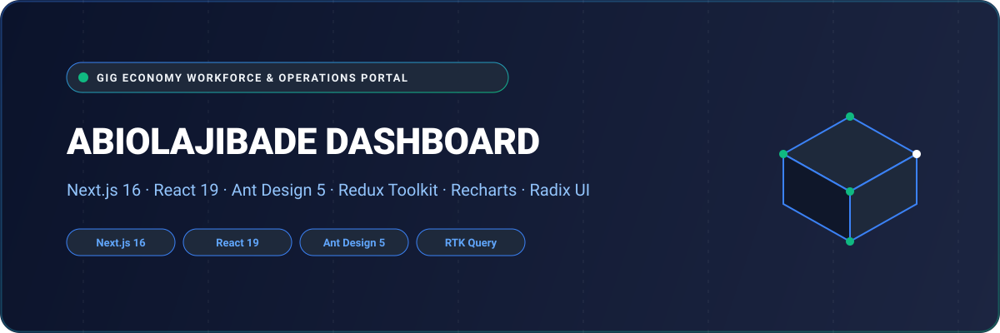

<div align="center">



# Abiola Jibade Dashboard — Workforce & Operations Management Console

An enterprise administrative dashboard engineered for marketplace operations, worker verification, booking management, and financial reconciliation. Developed with **Next.js 16 (App Router)**, **React 19**, **Ant Design 5**, **Radix UI**, **Tailwind CSS 4**, and **Redux Toolkit**.

[](https://nextjs.org/)
[](https://react.dev/)
[](https://ant.design/)
[](https://tailwindcss.com/)
[](https://redux-toolkit.js.org/)
[](LICENSE)

</div>

---

## 🌟 Overview

**Abiola Jibade Dashboard** gives platform operators and superadmins complete visibility and authority across the gig workforce ecosystem. From reviewing worker credential applications and tracking live job appointments to processing withdrawal disbursements and arbitrating disputed tasks, the console consolidates core operational controls into a high-performance web interface.

Integrated with [`abiolajibade_backend`](https://github.com/shahjalal-labs/abiolajibade_backend), it delivers real-time synchronicity and automated administrative workflows.

---

## 🚀 Key Features & Capabilities

- 📊 **Executive Metrics & Visual Analytics**: Interactive KPIs powered by Recharts, detailing completed bookings, active workers, customer satisfaction, and gross transaction value (GTV).
- 🧑‍🔧 **Worker Credentialing & Verification**: Identity review, skill certificate inspection, availability audits, and approval/rejection workflows.
- 📋 **Job & Booking Orchestration**: Real-time status inspection across all job posts, proposals, active assignments, and completion proofs.
- 💰 **Withdrawal & Escrow Reconciliation**: Multi-currency worker balance oversight, Stripe payout approvals, and transaction audit trails.
- ⚖️ **Dispute Arbitration & Review Moderation**: Two-way feedback inspection, customer report escalation, and resolution tools.
- 🔒 **Enterprise Role Governance**: Granular permissions, OTP multi-factor access, session persistence, and audit logging.

---

## 🏛️ System Architecture

```
[ Operations Team / SuperAdmin ]
              │
              ▼
   [ Next.js 16 App Router UI ]
   ├── Executive Analytics & KPI Cards
   ├── Worker Profile & Onboarding Audit
   ├── Job Board & Booking State Pipeline
   ├── Payouts & Stripe Ledger Reconciliation
   └── Dispute Arbitration Portal
              │
              ▼ (RTK Query / JWT Session)
   [ Abiola Jibade Backend API ] ──► [ Prisma / Database ]
```

---

## 📁 Repository Structure

```
abiolajibade_dashboard/
├── assets/
│   └── banner.svg                  # Architectural SVG project banner
├── public/                         # Brand icons, illustrations, and static assets
├── app/
│   ├── (auth)/                     # Administrative authentication routes
│   │   ├── login/                  # Secure administrator sign-in
│   │   └── forgot-password/        # Credential recovery
│   ├── (dashboard)/                # Primary operations portal
│   │   ├── appointment-overview/   # Master calendar and scheduled appointments
│   │   ├── job-management/         # Live gig listings, bidding status & fulfillment
│   │   ├── worker-management/      # Worker profiles, credentials, badges & statuses
│   │   ├── user-management/        # Customer directory and membership tiers
│   │   ├── withdraw-requests/      # Payout approvals and Stripe transfer logs
│   │   ├── report-management/      # Disputed deliverables and incident reports
│   │   ├── review-management/      # Moderation of client & worker evaluations
│   │   └── settings/               # Platform policies, commission rates & notifications
│   ├── layout.tsx                  # Root layout with Ant Design & Redux Providers
│   └── globals.css                 # Tailwind CSS 4 design tokens
├── components/                     # Reusable data tables, metric cards, and modals
├── redux/                          # Centralized state management & RTK Query APIs
├── lib/                            # Utility helpers, date formatters, and auth tokens
├── package.json                    # Project dependencies (Next.js 16, React 19, Ant Design 5)
└── tsconfig.json                   # Strict TypeScript compiler options
```

---

## 💻 Tech Stack Specification

| Domain | Selected Technologies |
| :--- | :--- |
| **Framework** | Next.js 16.0.10 (App Router, Turbopack) |
| **Runtime & React** | React 19.2.0 |
| **Language** | TypeScript 5 (Strict Mode) |
| **UI Design System** | Ant Design 5.28, Radix UI Primitives, Lucide Icons |
| **Styling** | Tailwind CSS 4, PostCSS, Tailwind-Merge |
| **State Management** | Redux Toolkit (RTK), RTK Query, Redux Persist |
| **Charts & Data** | Recharts, React-ChartJS-2 |
| **Forms & Validation** | React Hook Form, Zod 4 Resolver |
| **Document Export** | jsPDF, html2pdf.js |

---

## 🛠️ Getting Started & Local Development

### Prerequisites

- **Node.js**: `v20.x` or higher
- **Package Manager**: `npm`, `yarn`, or `pnpm`

### 1. Clone the Repository

```bash
git clone https://github.com/shahjalal-labs/abiolajibade_dashboard.git
cd abiolajibade_dashboard
```

### 2. Install Dependencies

```bash
npm install
```

### 3. Configure Environment Variables

Create a `.env.local` file:

```env
NEXT_PUBLIC_BASE_URL_LOCAL=http://localhost:5000/api/v1
```

### 4. Run Development Server

```bash
npm run dev
```

Open [http://localhost:3000](http://localhost:3000) to view the administration console.

---

## 👨‍💻 Engineering & Authorship

Developed and engineered by **Md. Shahjalal**.

- **GitHub**: [@shahjalal-labs](https://github.com/shahjalal-labs)
- **Email**: [muhommodshahjalal@gmail.com](mailto:muhommodshahjalal@gmail.com)

---

## 📄 License

This project is open-source and available under the [ISC License](LICENSE).
